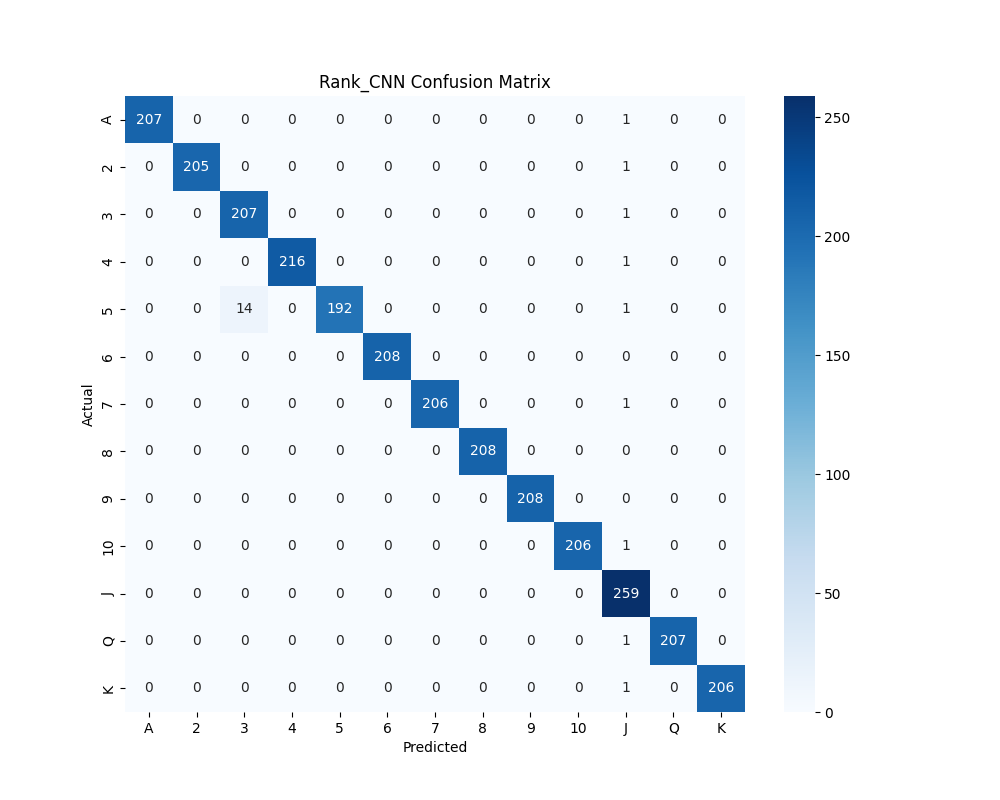
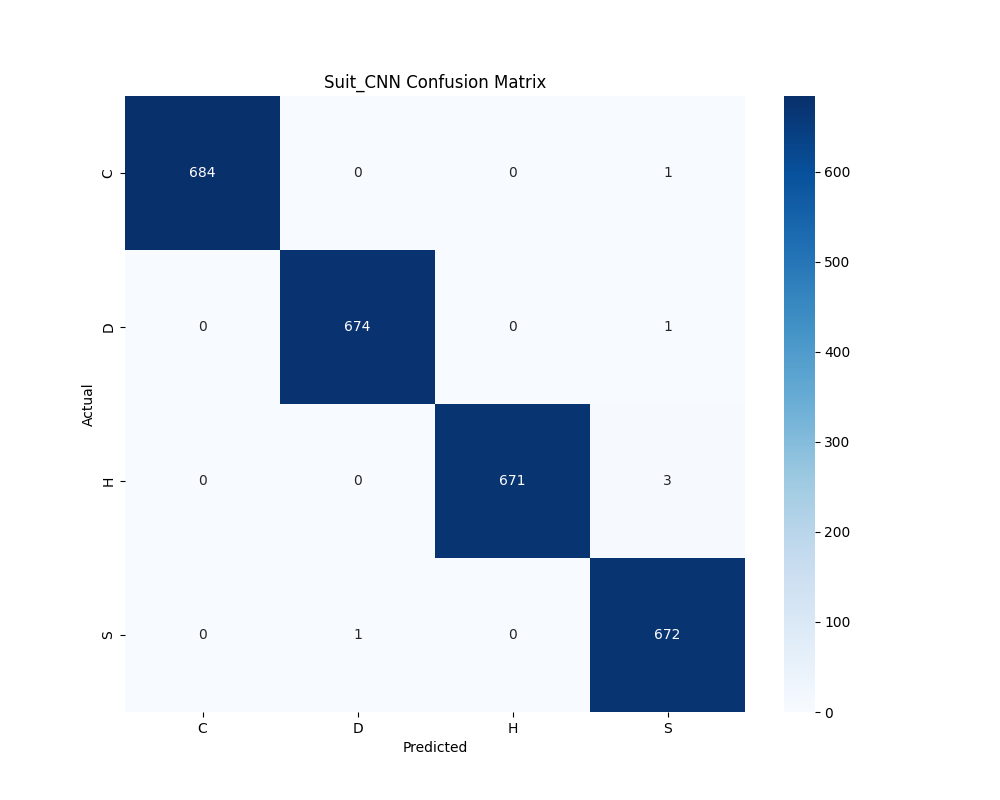

# Real-Time Playing Card Recognition: Single-Stage vs. Two-Stage

Detects and identifies playing cards from a live webcam feed, built two ways and compared head to head:

1. **Single-stage:** one YOLOv8 model locates the card and classifies it into one of 52 card classes in a single pass.
2. **Two-stage:** a YOLOv8 detector finds the card, then two ResNet-18 classifiers read its rank and suit from the cropped region.

Final project for CS 4337 (Computer Vision) at Texas State University, Fall 2025, by Daniel Almanza and Johnathan Carrizales. The full write-up is in [`CS4337 FINAL_REPORT.pdf`](CS4337%20FINAL_REPORT.pdf), and a recorded demo is in [`ProjectVideo.mp4`](ProjectVideo.mp4).

## Why two approaches

Card recognition looks simple, but the information that identifies a card lives in two small corner symbols. In a webcam frame those symbols are a few dozen pixels across, and they change with lighting, angle, distance, and motion blur. The project asks whether it's better to have one model handle localization and fine-grained classification together, or to split the problem so a detector handles "where" and dedicated classifiers handle "what."

## Pipelines

### Single-stage: YOLOv8 end to end (`one-stagecode/`)

- Converts the dataset's Pascal VOC XML annotations to YOLO format and remaps Kaggle's label IDs onto a fixed 52-card class map
- Fine-tunes a pretrained YOLOv8n on CPU (10 epochs, batch 4, AdamW, built-in mosaic, flip, and HSV augmentation)
- Evaluates with Ultralytics mAP plus a custom per-image script that takes the top-confidence detection, then reports precision, recall, F1, and a 52×52 confusion matrix
- Real-time webcam demo in OpenCV at about 30 FPS. The model tends to box the corner symbol rather than the whole card, so the demo scales each box up to cover the full card before drawing it.

### Two-stage: YOLOv8 detection + ResNet-18 classification (`two-stagecode/`)

- Crops every annotated card out of the source images and sorts the crops into rank (13 classes) and suit (4 classes) folders
- Trains two ResNet-18 classifiers from ImageNet weights, one for rank and one for suit, with rotation, color-jitter, and random-crop augmentation
- At runtime, YOLO proposes boxes, a size and aspect-ratio filter discards boxes that aren't card-shaped, and each surviving crop goes through both classifiers
- Evaluation script produces per-class reports and confusion matrices for both classifiers

## Results

| | Single-stage (YOLOv8n) | Two-stage (ResNet-18) |
|---|---|---|
| Top-1 accuracy | 94.3% | Rank 99%, suit 100% |
| Precision / recall | 0.948 / 0.943 | Rank 0.99 / 0.99, suit 1.00 / 1.00 |
| mAP@50 / mAP@50–95 | 0.715 / 0.447 | — |

<p>
  
  
</p>

**Reading these numbers:** both pipelines were scored on images they had also trained on (the single-stage config points train and val at the same folder, and the CNN test runs over the full crop set). The figures above show how well each model fits this dataset, not how it generalizes. The live demo is the better test: once a card was detected it was almost always classified correctly, but detection was the weak point, especially at a distance, at an angle, or in motion.

## What we found

- **Classification wasn't the hard part; detection was.** Both approaches identify a well-framed card reliably. Failures came from missed or unstable detections in real webcam footage.
- **Single-stage is simpler and faster to deploy,** but because the identifying features are tiny, YOLO learns to box the corner symbol instead of the whole card, which makes it sensitive to distance and angle.
- **Two-stage gives more control.** The classifiers always see a consistent, close-up crop, which is where its higher classification scores come from.
- **Most confusions were between look-alikes,** such as hearts vs. diamonds and adjacent ranks.

## What we'd do next

- Hold out a real validation and test split, and add webcam frames to the evaluation set
- Train the detector on full-card boxes at higher input resolution
- Add stronger augmentation for blur, glare, and perspective
- Compare speed directly (FPS and latency for both pipelines on the same hardware)

## Run it

Requires Python 3.9+ and a webcam. A GPU is optional; everything was trained on CPU.

```bash
git clone https://github.com/Da125673/CS4337FinalPoject.git
cd CS4337FinalPoject
python -m venv projectenv
source projectenv/bin/activate        # Windows: projectenv\Scripts\activate
pip install -r requirements.txt
# If Ultralytics fails to install:
# pip install git+https://github.com/ultralytics/ultralytics.git@main
```

Dataset: [The Complete Playing Card Dataset](https://www.kaggle.com/datasets/jaypradipshah/the-complete-playing-card-dataset) (Jay Pradip Shah, Kaggle). Place it under `dataset/`.

**Single-stage**

```bash
# Set `path` in one-stagecode/data.yaml to your local dataset folder first
python one-stagecode/train_single_stage.py
python one-stagecode/realtime_single_stage.py
```

**Two-stage**

```bash
python two-stagecode/CNN_training.py     # set DATASET_TYPE to "rank", then "suit"
python two-stagecode/CNN_test.py         # writes confusion matrices to CNNData/
python two-stagecode/Live_camera.py
```

Press `q` to close either webcam window.

## Repository layout

```
one-stagecode/
  convert_voc_to_yolo.py      VOC XML → YOLO labels
  remap_kaggle_yolo_labels.py Remap Kaggle label IDs to the 52-card class map
  card_classes.py             Class map shared by the scripts above
  train_single_stage.py       YOLOv8n training
  evaluate_single_stage.py    mAP evaluation
  evaluate_yolo_confusion.py  Per-image top-1 evaluation and confusion matrix
  accuracy_precision_recall.py Summary metrics from saved predictions
  realtime_single_stage.py    Webcam demo
two-stagecode/
  prepare_yolo_dataset.py     Train/val split for the detector
  cropping.py                 Crop cards into rank/ and suit/ folders
  check.py                    Image/label pairing check
  CNN_training.py             ResNet-18 training (rank or suit)
  CNN_test.py                 Classifier evaluation and confusion matrices
  Live_camera.py              Webcam demo
models/                       Trained rank and suit classifiers
CNNData/                      Classifier confusion matrices
CS4337 FINAL_REPORT.pdf       Full project report
ProjectVideo.mp4              Demo recording
```

## Stack

Python, PyTorch, torchvision (ResNet-18), Ultralytics YOLOv8, OpenCV, scikit-learn, NumPy, Matplotlib, seaborn

## Authors

- **Daniel Almanza:** two-stage pipeline (cropping, ResNet-18 rank and suit classifiers, two-stage webcam demo)
- **Johnathan Carrizales:** single-stage pipeline (annotation conversion and label remapping, YOLOv8 training, per-image evaluation and confusion matrix, single-stage webcam demo)

Both authors wrote the report and compared the two approaches together.
